# Mind Map Studio

[](https://github.com/huduzhu/mindmap/actions/workflows/ci.yml)

An offline-first mind mapping and brainstorming app that runs in your browser and installs as an
app (PWA). Your projects stay on your device: no account, no server, no tracking. An AI
assistant can expand your ideas or turn them into a structured map through a simple exchange of
JSON files, with no API key.

English and 简体中文 interface · works offline · keyboard- and touch-friendly · MIT licensed

<p align="center">
  
</p>

**Use it now:** <https://huduzhu.github.io/mindmap/> (built from `main` by
[`.github/workflows/pages.yml`](.github/workflows/pages.yml), run on demand). Everything still stays in your
browser. Note that all `*.github.io` project sites of one GitHub account share one origin, and so
one browser storage: other apps published under `huduzhu.github.io` could read what this one
stores there. If that matters to you, host your own copy (see [Hosting](#hosting)).

New here? Open the app and choose **Try the guide · 入门指南**, a bilingual map that teaches the
shortcuts by using them.

## Features

### Three views of one project

- **Mind map** canvas with automatic layout, branches on both sides, folding, drag to move or
  re-parent, cross-links between any two nodes, a minimap and zoom controls.
- **Brainstorm** outliner for quick bullets (`Enter` for the next idea, `Tab` / `Shift+Tab` to
  nest it, even while typing), and **Brainstorm → Copy to map** to turn them into a map.
- **Outline** view of the map, and a side-by-side **split view**.
- **Focus on one branch** to work in it as if it were the whole map, with a breadcrumb bar to
  climb back out, and **Export this branch…** to save just that part.
- **Fold** anything: `Space` on a node, `Alt+,` collapses all, `Alt+.` expands all, `Alt+1`…`3`
  show that many levels.

### Rich nodes

- **Notes** in Markdown, in a details panel you can show or hide (`Ctrl+I`).
- **Roles** such as theme, task, risk or question, styled by the theme.
- **Tasks** with a checkbox on the map and in the outlines; `Ctrl+Enter` ticks them, and a
  parent shows its progress ("3/5").
- **Colour and emoji markers**: a coloured bar from the theme's palette and an emoji before the
  title.
- **Labelled links**: name a cross-link ("depends on") and the label sits in the middle of it.
- **Tags**: end a title with `#p1 #backend` while renaming, or use the tag field. The **Tags**
  filter dims or hides everything else, and `#p1` works in search.
- **Images**: paste a screenshot (`Ctrl+V`) or drop a picture onto a node. It shows as a
  thumbnail, and a click opens it full size with zoom and a description for screen readers.
  Pictures are scaled down and stored once, outside the project file.

### Present

`F5` (or **Present** in the toolbar) walks through the map full screen, one node at a time:
the central topic, then each branch clockwise, with the camera gliding to each step and the rest
of the map dimmed. Arrow keys, `Space` or a click go on; `B` blanks the screen, `N` shows the
node's notes; `Esc` leaves. Presenting never changes your project. Exported HTML pages can
present too.

### Find, edit and navigate from the keyboard

`Ctrl+K` opens a command palette with every action, and `Ctrl+F` searches every node, including
folded and off-screen ones. Every dialog and menu works from the keyboard. See
[Keyboard shortcuts](#keyboard-shortcuts) below, or the **?** button in the app's hint bar.

### Safe with your data

- Autosave to the browser (IndexedDB); the app reopens where you left off.
- Persistent undo history, named snapshots, and a Trash with 30-day auto-delete.
- Whole-library backup and restore as one ZIP, including images.
- A storage meter with "keep my data", and protection against two tabs overwriting each other.

### Sync and share

- **Sync between computers** through a folder in OneDrive (or any synced folder) in Chrome or
  Edge on a computer. Conflicts keep both versions, and nothing is deleted outright.
- **GitHub milestones**: save a project to a private GitHub repository as a commit (optionally
  tagged) and bring any milestone back as a snapshot.
- **Import and export**: project JSON, Markdown and OPML outlines, FreeMind, PNG, SVG, a
  self-contained interactive HTML page, and ZIPs with images. Drop a file anywhere to import it.
- **Print or save as PDF**: `Ctrl+P` prints the whole map on one page, or the outline.

### Looks, languages and accessibility

- Style presets, including one that follows your device's light or dark setting. Make your own
  in the preset editor (colours, typeface, lines, with a live preview and a contrast check).
- English and Simplified Chinese interface, switchable at any time.
- Screen readers hear every edit ("Added “Pricing” under “Launch”"), nodes and outline rows are
  labelled, and keyboard focus is always visible.
- Touch editing on phones and tablets: an action bar for the selected node, long-press for the
  node menu, double-tap to rename.

## Install it as an app

Mind Map Studio is a Progressive Web App. Once installed it opens in its own window and works
fully offline.

- **Chrome or Edge on a computer:** click the install icon at the right of the address bar, or
  open the browser menu and choose **Install Mind Map Studio** (Edge: **Apps → Install this site
  as an app**).
- **Android (Chrome):** browser menu → **Install app** or **Add to Home screen**.
- **iPhone or iPad (Safari):** Share → **Add to Home Screen**.

Updates arrive in the background. When a new version is ready the app shows a banner, saves your
work and reloads when you choose. Your projects live in that browser's storage on that device,
so use **Back up all projects** on the start screen, or folder sync, to keep a copy elsewhere.

## Quick start (development)

Requires Node.js 24 (see `.nvmrc`).

```bash
npm ci
npm start          # dev server on http://localhost:5173 (npm stop stops it)
npm test           # unit and component tests
```

Production build:

```bash
npm run build      # type-check, build the HTML-export viewer, then the app into dist/
npm run preview    # serve dist/ locally
npm run package    # build, then write a source zip and an app-only zip into release/
```

Deploy `dist/` as static files. By default the build expects the **site root**
(`https://example.com/`). For a sub-path, set `BASE_PATH` when building, e.g.
`BASE_PATH=/mindmap/ npm run build` (PowerShell: `$env:BASE_PATH='/mindmap/'; npm run build`);
asset URLs, the manifest and the service worker then all stay inside that path. The app needs
HTTPS, or `localhost`, to install and to work offline.

See [CONTRIBUTING.md](CONTRIBUTING.md) for the checks to run before every change.

## Hosting

`dist/` is plain static files; any static host works. The production build puts a
Content-Security-Policy `<meta>` tag into `index.html`, so even hosts that cannot set headers
(such as GitHub Pages) get it. On top of that, send these response headers where your host
allows it — they are what a meta tag cannot do:

- `Content-Security-Policy`: the same policy plus `frame-ancestors 'none'` (stops other sites
  from framing the app),
- `X-Content-Type-Options: nosniff`,
- `Referrer-Policy: no-referrer`.

[`public/_headers`](public/_headers) has all three, ready for **Netlify** and **Cloudflare
Pages** (it is copied into `dist/`). Elsewhere, copy the values from that file: for example
`add_header` lines in an **nginx** `server` block, `Header set` in an **Apache** `.htaccess`,
or a `headers` entry in **Vercel**'s `vercel.json`. The policy is the single source: the meta
tag is generated from it at build time, so change it there.

## Keyboard shortcuts

On a Mac, use `⌘` instead of `Ctrl`.

| Keys | Action |
|---|---|
| `Tab` / `Enter` | Add a child / a sibling (on the map) |
| `F2` or double-click | Rename |
| Arrow keys | Move the selection (they follow the sides of the map) |
| `Ctrl+]` / `Ctrl+[` | Indent / outdent (in Brainstorm also `Tab` / `Shift+Tab`) |
| `Space` · `Alt+,` · `Alt+.` · `Alt+1`…`3` | Fold · collapse all · expand all · show levels |
| `Alt+→` / `Alt+←` | Focus on the selected branch / go back up |
| `Ctrl+Enter` | Tick a task (or make the node a task) |
| `Ctrl+C` / `Ctrl+X` / `Ctrl+V` | Copy, cut and paste branches (paste an image onto a node) |
| `Ctrl+Z` / `Ctrl+Y` | Undo / redo |
| `Ctrl+F` | Search every node (`Enter` / `Shift+Enter` step through matches) |
| `Ctrl+K` | Command palette |
| `Ctrl+I` | Show or hide the details panel |
| `F5` / `Shift+F5` | Present / present from the selected node |
| `Ctrl+P` | Print or save as PDF |

## Syncing between computers

1. Open **Sync folder…** (start screen or Project ▾) in Chrome or Edge and choose a folder inside
   OneDrive, for example `OneDrive\MindMaps`. Allow the site to edit files there ("Allow on every
   visit" if offered).
2. In File Explorer, right-click that folder and choose **Always keep on this device**.
3. Do the same on your other computers with the same folder.

Each project is a file `<name> (<id>).mindmap.json`, a normal project file you can also import;
pictures go in `_assets/`. The app writes about 10 seconds after you stop editing, at once on
Save or when you switch away, and reads changes from the other computers when you come back to
the window.

- **Conflicts:** if both computers changed a project, the newer one stays and the other is kept
  as a conflict copy tagged `conflict`.
- **Deletions:** removed projects go to the folder's `_trash` subfolder. If many files vanish at
  once, sync pauses and asks first.
- **Restores and presets:** restoring a project from the Trash brings it back on the other
  computers too, and custom presets travel the same way.
- **Version mismatches:** a file made by a newer version of the app is reported and left alone
  until that computer is updated.

## Working with an AI assistant

The app never calls an AI itself. Instead it hands your AI a file and takes the answer back:

1. **Export ▾ → For AI…** and pick what you want:
   - **expand**: more ideas for the brainstorm (append-only);
   - **convert**: turn the brainstorm into a structured mind map;
   - **improve**: sharpen titles, grouping and notes in both.
2. Give the downloaded packet to your assistant together with the skill in [`skill/`](skill/).
   Copy the folder into your assistant's skills directory and run it from a checkout of this
   repository, so it can validate its output against [`schemas/`](schemas/).
3. **Import** the JSON file it returns. Because the reply names the project it came from, the app
   offers to put it back into that project as a single undo step. You can import it as a
   separate project instead.

File formats are JSON Schemas in [`schemas/`](schemas/) and are described in
[`skill/references/schemas.md`](skill/references/schemas.md); ready-made samples are in
[`examples/`](examples/). Files that use newer optional features (tasks and markers, tags,
images) say so with `"app": { "minVersion": n }`, so an older version of the app reports such a
file instead of changing it. Files that don't use them stay readable by every version.

## Development

| Command | What it does |
|---|---|
| `npm start` / `npm stop` | Start / stop the dev server (port 5173) |
| `npm test` | Unit and component tests (Vitest, jsdom) |
| `npm run e2e` | Browser tests (Playwright); `npm run e2e:install` fetches Chromium once |
| `npm run lint` | oxlint (warnings fail) |
| `npm run format` / `format:check` | Prettier |
| `npm run validate -- <file>` / `validate:fixtures` | Check a JSON document / all fixtures against the schemas |
| `npm run repair -- <file>` | Fill the wrapper fields an AI reply may have left out |
| `npm run notices` | Regenerate `THIRD_PARTY_NOTICES.md` after changing runtime dependencies |
| `npm run size` | Check the JavaScript loaded at startup against the 575 KB budget (after a build) |
| `npm run bench` | Time editing a generated 1,571-node map (needs `npm run preview` running) |
| `npm run package` | Build, then write `release/mindmap-studio-<version>-<sha>.zip` (source and app) and `-app.zip` (the app only, ready to serve) |

CI runs lint, formatting, fixtures, unit tests, the build, the bundle budget, `npm audit` and the
browser tests on every push and pull request.

## Project layout

| Path | Contents |
|---|---|
| `src/components/` | React UI: canvas, outliner, toolbar, dialogs |
| `src/store/` | State (zustand): projects, editor and undo, UI |
| `src/io/` | IndexedDB, import/export, backup, ZIP |
| `src/map/` | Layout, text measurement and navigation for the canvas |
| `src/sync/` | Folder sync and GitHub milestones |
| `src/assets/` | Image processing and the picture store |
| `src/present/` | Presentation mode |
| `src/i18n/` | Interface text (English, 简体中文) |
| `src/viewer/` | The standalone viewer embedded in HTML exports |
| `schemas/`, `presets/`, `examples/`, `fixtures/` | Document formats, built-in styles, samples, test data |
| `skill/` | The AI assistant skill for the round trip |
| `e2e/` | Playwright browser tests |

## Contributing

Bug reports and ideas are welcome. Please use the issue templates, and read
[CONTRIBUTING.md](CONTRIBUTING.md) before opening a pull request.

## License

MIT — see [`LICENSE`](LICENSE).
